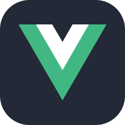
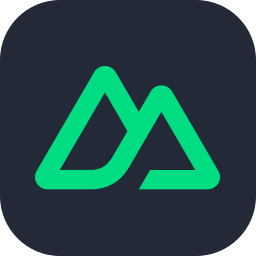
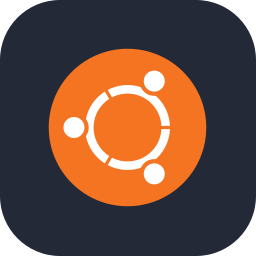
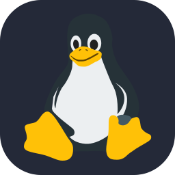
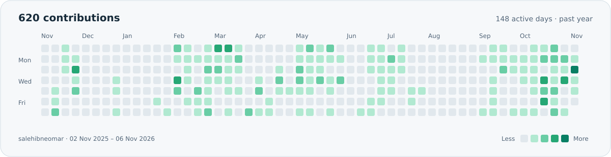

<picture>
  <source media="(prefers-color-scheme: dark)" srcset="assets/profile-banner-dark.svg">
  
</picture>

<h1 align="center">Hi, I'm Saleh Ibne Omar 👋</h1>

  <strong>Product Developer · Solution Architect · Full-Stack Developer</strong> 
  🇧🇩 Bangladesh &nbsp; · &nbsp; 🐧 Ubuntu daily driver &nbsp; · &nbsp; 🎓 Forever a student

  
  
  

I turn **business problems into complete software products**, from planning and architecture to development, deployment, and launch. Right now, I'm **building my own products**, combining full-stack engineering with AI-powered workflows.

<picture>
  <source media="(prefers-color-scheme: dark)" srcset="assets/highlights-dark.svg">
  
</picture>

## 🚀 From problem to product

| 🏗️ Product engineering | 🧠 AI-powered solutions |
| :--- | :--- |
| End-to-end ownership: business needs, planning, architecture, development, and deployment. | LLM integration, retrieval-augmented generation (RAG), and AI features that solve business problems. |
| Scalable backends, reusable frontend components, databases, caching, and Redis. | AI-assisted product planning and launch content, including social posts and promotional graphics. |

## 🛠️ Technologies I work with

<!-- Skill icons by tandpfun/skill-icons (MIT); license retained in assets/icons/LICENSE. -->

**Languages**

  
  
  
  

**Frameworks & interfaces**

  
  
  
  

Laravel · Vue.js · Nuxt · React · **Quasar**

**Data, infrastructure & deployment**

  
  
  
  
  
  

MySQL · PostgreSQL · Redis · Caching · **cPanel · Vercel · Laravel Cloud**

🐧 **Ubuntu** is my primary OS; I also work with **Windows and macOS**. My deployment experience spans shared hosting, managed and serverless platforms, and manually configuring a complete Linux development environment to operate like a VPS.

### 🤖 My AI development workspace

  
  
  
  

I use agentic development tools throughout **planning, implementation, and launch**, combining AI-assisted delivery with engineering judgment and ownership of the final product.

## 📊 GitHub activity

<!-- Generated from real public GitHub contributions; refreshed by .github/workflows/contributions.yml. -->
<picture>
  <source media="(prefers-color-scheme: dark)" srcset="assets/contributions-dark.svg">
  
</picture>

  <picture>
    <source media="(prefers-color-scheme: dark)" srcset="https://github-profile-summary-cards.vercel.app/api/cards/stats?username=salehibneomar&amp;theme=github_dark">
    
  </picture>
  <picture>
    <source media="(prefers-color-scheme: dark)" srcset="https://github-profile-summary-cards.vercel.app/api/cards/repos-per-language?username=salehibneomar&amp;theme=github_dark">
    
  </picture>

<a href="https://github.com/salehibneomar?tab=repositories">🔎 Explore my repositories</a>

## ⚙️ Engineering principles

- 🧩 **Clean, maintainable code** — clear responsibilities and reusable frontend components.
- ⚡ **Scalable, efficient backends** — deliberate database, caching, and architecture choices.
- 🔐 **Environment-based configuration** — `.env` files keep settings separate from application code.
- 🎯 **Product ownership** — understand the problem, design the solution, ship it, and support the launch.

## 🎓 Education & problem solving

| | Journey |
| :--- | :--- |
| 🎓 **MSc** | **Jahangirnagar University** · In progress |
| 🏅 **BSc** | **Southeast University** · Completed · **CGPA 3.89** |
| 🧠 **Problem solving** | **400+ programming problems solved** |
| 🌱 **The beginning** | Started developing projects with **PHP in 2018** |

[Education →](https://salehibneomar.infinityfreeapp.com/education) · [Problem-solving journey →](https://salehibneomar.infinityfreeapp.com/problem-solving)

---

  <strong>💡 Have a business problem or a product idea? Let's build something useful.</strong>  
  <a href="https://bd.linkedin.com/in/salehibneomar">LinkedIn</a> &nbsp; · &nbsp;
  <a href="https://salehibneomar.infinityfreeapp.com/">Portfolio</a> &nbsp; · &nbsp;
  <a href="https://www.slideshare.net/SalehIbneOmar">SlideShare</a>

