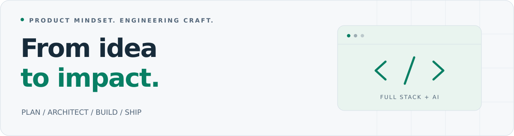

<picture>
  <source media="(prefers-color-scheme: dark)" srcset="assets/profile-banner-dark.svg">
  <source media="(prefers-color-scheme: light)" srcset="assets/profile-banner-light.svg">
  
</picture>

# Saleh Ibne Omar

**Product Developer · Solution Architect · Full-Stack Developer** 
Based in Bangladesh. Building since 2018. Forever a student.

I turn business problems into complete software products, from planning and architecture to development, deployment, and launch. I'm currently building my own products, combining full-stack engineering with AI-powered workflows.

[Portfolio](https://salehibneomar.infinityfreeapp.com/) · [LinkedIn](https://bd.linkedin.com/in/salehibneomar) · [Experience](https://salehibneomar.infinityfreeapp.com/experiences) · [Problem solving](https://salehibneomar.infinityfreeapp.com/problem-solving)

| Professional experience | Freelance experience | Programming problems solved |
| :--- | :--- | :--- |
| **3 years** | **2 years** | **400+** |

## What I build

- **End-to-end products** — translate business needs into plans, application architecture, reusable interfaces, and production deployments.
- **Full-stack applications** — build scalable backends and component-based frontends, with databases, caching, and Redis.
- **AI-powered solutions** — integrate LLMs and retrieval-augmented generation (RAG) into applications to solve business problems.
- **Product launches** — use AI to support product planning and business promotion, including social posts and promotional graphics.

## My toolkit

| Area | Technologies & tools |
| :--- | :--- |
| Languages | PHP · JavaScript · Python · Java |
| Backend | Laravel · MySQL · PostgreSQL · Redis · Caching |
| Frontend | Vue.js · Nuxt · React · Quasar |
| AI & agentic development | LLM integration · RAG · Claude Pro · Codex Plus · Gemini Pro · Copilot Pro |
| Deployment | cPanel · Vercel · Laravel Cloud · Manual Linux server setup |
| Operating systems | Ubuntu (primary) · Windows · macOS |

## How I work

I take ownership across the product lifecycle: understanding the problem, designing the solution, writing the code, and getting it into users' hands.

- **Clean, maintainable code** with clear responsibilities and reusable components.
- **Scalable, efficient backends** with deliberate database and caching choices.
- **Environment-based configuration** using `.env` files to keep settings separate from application code.
- **AI-assisted delivery** across planning, implementation, and launch, grounded in engineering judgment.

My deployment experience includes managed and serverless platforms, shared hosting, and manually configuring a complete Linux development environment to operate like a VPS.

## Learning & foundations

| Education | Status |
| :--- | :--- |
| **MSc · Jahangirnagar University** | In progress |
| **BSc · Southeast University** | Completed · **CGPA 3.89** |

I started developing projects with PHP in **2018** and have solved **400+ programming problems**, building a foundation in analytical thinking and problem solving.

[More about my education →](https://salehibneomar.infinityfreeapp.com/education)

---

**Have a business problem or a product idea? Let's connect.** 
[LinkedIn](https://bd.linkedin.com/in/salehibneomar) · [Portfolio](https://salehibneomar.infinityfreeapp.com/) · [SlideShare](https://www.slideshare.net/SalehIbneOmar)
