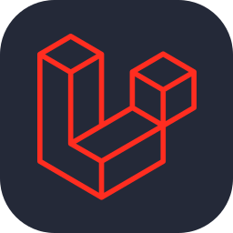
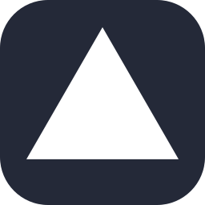
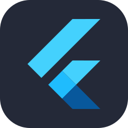
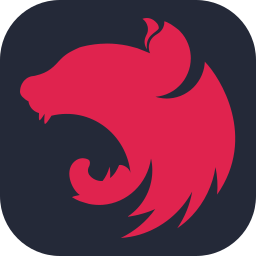

<picture>
  <source media="(prefers-color-scheme: dark)" srcset="assets/profile-banner-dark.svg">
  
</picture>

<h1 align="center">Hi, I'm Saleh Ibne Omar 👋</h1>

  <strong>Product Engineer · Solution Architect · Full-Stack Developer</strong> 
  🇧🇩 Bangladesh   ·   🐧 Ubuntu daily driver   ·   🎓 Forever a student

  
  
  

I build software that solves business problems. I work across planning, architecture, development, deployment, and launch. Right now, I'm building my own products and using AI throughout the process.

  <table>
    <tr>
      <td align="center" width="25%">
        

          <h3>💼 3 years</h3>
          
Software Engineer Full-time, office-based

        

      </td>
      <td align="center" width="25%">
        

          <h3>💻 2 years</h3>
          
Freelance experience

        

      </td>
      <td align="center" width="25%">
        

          <h3>🧠 400+</h3>
          
Problems solved

        

      </td>
      <td align="center" width="25%">
        

          <h3>🌱 2018</h3>
          
First PHP projects

        

      </td>
    </tr>
  </table>

## 🎓 Education & professional development

  <table>
    <tr>
      <td align="center" valign="top" width="50%">
        

          
          <h3>Jahangirnagar University</h3>
          
MSc Currently pursuing

        

      </td>
      <td align="center" valign="top" width="50%">
        

          
          <h3>Southeast University</h3>
          
BSc completed CGPA 3.89

        

      </td>
    </tr>
  </table>

**📘 Project management training · Udemy** 
Completed The Project Management Course: Beginner to PROject Manager.

[More about my education →](https://salehibneomar.infinityfreeapp.com/education)

## 🚀 From problem to product

| 🏗️ Product engineering | 🧠 AI-powered solutions |
| :--- | :--- |
| I take products from understanding the business need through planning, architecture, development, and deployment. | I integrate LLMs and retrieval-augmented generation (RAG) to solve practical business problems. |
| I build scalable backends and reusable interfaces, with databases, caching, and Redis where they fit. | I also use AI for product planning and launch content, including social posts and promotional graphics. |

## 🤝 Leadership & delivery

I can manage projects, lead teams, and mentor junior developers. I'm used to working in fast-paced Agile and Scrum teams, setting priorities together and adapting when requirements change.

I can pick up new tools and technologies on demand and adapt to what a project needs.

## 🛠️ Technologies I work with

<!-- Skill icons by tandpfun/skill-icons (MIT). License retained in assets/icons/LICENSE. -->

**Languages**

  
  
  
  
  

PHP · JavaScript · Python · Java · C++

**Frameworks & interfaces**

  
  
  
  

Laravel · Vue.js · Nuxt · React · Quasar

**Data, infrastructure & deployment**

  
  
  
  
  
  

MySQL · PostgreSQL · Redis · Caching · cPanel · Vercel · Laravel Cloud

🐧 I use Ubuntu every day and also have experience with Windows and macOS. My deployment experience spans shared hosting, managed and serverless platforms, and manually configuring a complete Linux development environment to operate like a VPS.

### 🌱 Currently learning

  
  

Expanding my toolkit with Flutter and NestJS.

### 🤖 My AI development workspace

  
  
  
  

I use AI tools to help plan, build, and launch products. I stay responsible for the technical decisions and the quality of what I ship.

**I design projects so AI agents can work with them effectively.**

- 🗂️ I give projects clear structure and boundaries so agents can find the right code and make focused changes.
- 📋 I write project rules and coding conventions to help agents produce more accurate, consistent work and use fewer tokens.
- ✍️ I write detailed prompts that explain the business problem, architecture, constraints, and expected result so agents have the context they need.

## 📊 GitHub activity

<!-- Generated from public GitHub contributions. Refreshed by .github/workflows/contributions.yml. -->
<picture>
  <source media="(prefers-color-scheme: dark)" srcset="assets/contributions-dark.svg">
  
</picture>

  <picture>
    <source media="(prefers-color-scheme: dark)" srcset="https://github-profile-summary-cards.vercel.app/api/cards/stats?username=salehibneomar&amp;theme=github_dark">
    
  </picture>
  <picture>
    <source media="(prefers-color-scheme: dark)" srcset="https://github-profile-summary-cards.vercel.app/api/cards/repos-per-language?username=salehibneomar&amp;theme=github_dark">
    
  </picture>

<a href="https://github.com/salehibneomar?tab=repositories">🔎 Explore my repositories</a>

## ⚙️ Engineering principles

- 🧩 I keep code clean and maintainable, with clear responsibilities and reusable frontend components.
- ⚡ I build scalable, efficient backends and choose databases and caching strategies to fit the workload.
- 🔐 I use environment-based configuration with `.env` files to keep settings separate from application code.
- 🎯 I take ownership of the product, from understanding the problem to shipping the solution and supporting its launch.

## 🧠 Problem-solving foundations

I've solved 400+ programming problems and started developing projects with PHP in 2018. That foundation shapes how I break down business problems and design practical solutions.

[My problem-solving journey →](https://salehibneomar.infinityfreeapp.com/problem-solving)

---

  <strong>💡 Have a business problem or a product idea? Let's build something useful.</strong>  
  <a href="https://bd.linkedin.com/in/salehibneomar">LinkedIn</a>   ·
  <a href="https://salehibneomar.infinityfreeapp.com/">Portfolio</a>   ·
  <a href="https://www.slideshare.net/SalehIbneOmar">SlideShare</a>

